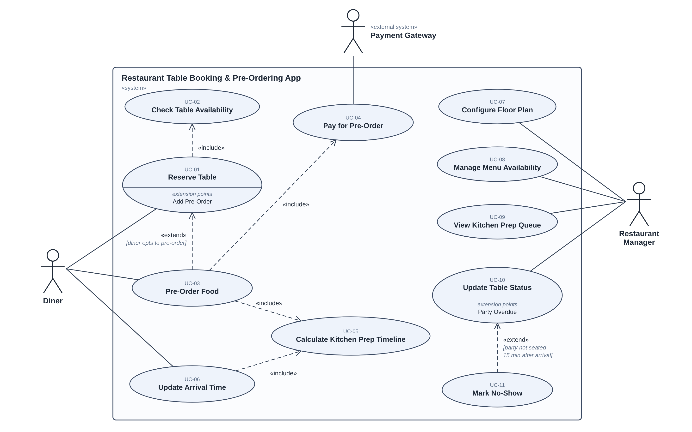

# Lab 1 — Requirements Engineering & UML Use-Case Modelling

**Problem Statement #36 — Restaurant Table Booking & Pre-Ordering App** (Retail, E-Commerce & Finance)
PES1UG24CS526

A restaurant hospitality app that lets diners pick a specific table on a live floor plan, place an advance food order, and have the kitchen's preparation timeline calculated so the food is ready when they arrive.

## Deliverables

| Deliverable | File(s) |
|---|---|
| Requirements table — FR-001 to FR-005, NFR-001 & NFR-002 (ID, Type, Description, Priority, Acceptance Criteria, Rationale) | [requirements.md](requirements.md) |
| UML use-case diagram — all actors, primary use cases, «include» and «extend» | [use-case-diagram.png](use-case-diagram.png) · [use-case-diagram.svg](use-case-diagram.svg) · source: [use-case-diagram.puml](use-case-diagram.puml) |
| Use-case flow specification (1 page) — UC-01 Reserve Table | [use-case-specification.md](use-case-specification.md) · [use-case-specification.pdf](use-case-specification.pdf) |

## Use-Case Diagram

**Actors:** Diner and Restaurant Manager (primary), Payment Gateway (secondary, external system).

**Relationships**

| Type | From → To | Meaning |
|---|---|---|
| «include» | UC-01 Reserve Table → UC-02 Check Table Availability | Every booking checks the table is free for the whole dining window (no overbooking). |
| «include» | UC-03 Pre-Order Food → UC-04 Pay for Pre-Order | A pre-order is confirmed only after payment. |
| «include» | UC-03 Pre-Order Food → UC-05 Calculate Kitchen Prep Timeline | Confirming a pre-order schedules its kitchen tickets. |
| «include» | UC-06 Update Arrival Time → UC-05 Calculate Kitchen Prep Timeline | A new arrival time reschedules unfired tickets. |
| «extend» | UC-03 Pre-Order Food → UC-01 Reserve Table (point *Add Pre-Order*) | Optional: only when the diner chooses to pre-order while booking. |
| «extend» | UC-11 Mark No-Show → UC-10 Update Table Status (point *Party Overdue*) | Only when the party is not seated 15 min after the arrival time. |

The requirement each use case traces to is listed in [requirements.md](requirements.md#traceability-use-cases--requirements).
