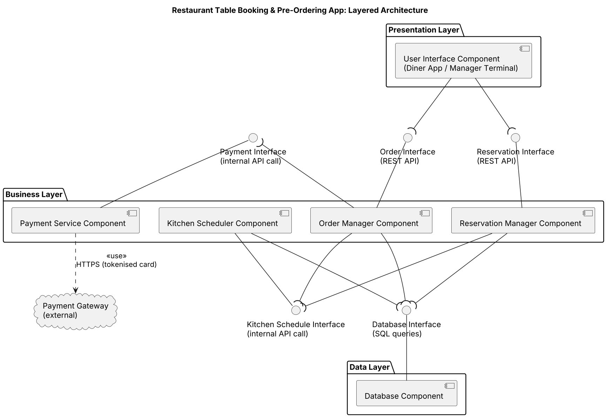

# Lab 3: Component Modelling & Architectural Pattern Selection

**System:** Restaurant Table Booking & Pre-Ordering App
**Architecture:** Layered

## Deliverables

| Deliverable | File(s) |
|---|---|
| Component diagram | [component-diagram.png](component-diagram.png) (source: [component-diagram.puml](component-diagram.puml)) |
| Written justification | [justification.pdf](justification.pdf) ([justification.docx](justification.docx)) |

## Components

1. User Interface Component (Presentation Layer)
2. Reservation Manager Component (Business Layer)
3. Order Manager Component (Business Layer)
4. Kitchen Scheduler Component (Business Layer)
5. Payment Service Component (Business Layer)
6. Database Component (Data Layer)

## Interfaces

| Interface | Provided by | Required by | Protocol |
|---|---|---|---|
| Reservation Interface | Reservation Manager | User Interface | REST API |
| Order Interface | Order Manager | User Interface | REST API |
| Payment Interface | Payment Service | Order Manager | Internal API call |
| Kitchen Schedule Interface | Kitchen Scheduler | Order Manager, Reservation Manager | Internal API call |
| Database Interface | Database | Reservation Manager, Order Manager, Kitchen Scheduler | SQL queries |
